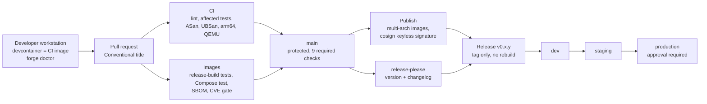

# SwarmForge

[](https://github.com/penchalj/swarmforge/actions/workflows/ci.yml)
[](https://github.com/penchalj/swarmforge/actions/workflows/images.yml)
[](https://github.com/penchalj/swarmforge/releases)

**A reproducible build, CI/CD and release platform for a C++/Python autonomy stack:
from developer laptop to signed, multi-arch release, promoted dev → staging → production.**

I built SwarmForge from an empty repository to show how I would approach the
engineering platform behind autonomous systems: hermetic builds, fast CI,
supply-chain integrity and safe releases for x86 servers and ARM edge devices.
It is an independent reference project; the domain code (a Kalman tracker fed
by a simulated sensor) uses synthetic data only.

## Results at a glance

All numbers are measured on this repository ([details](docs/performance/ci-timings.md)).

| What | Result |
|------|--------|
| Full CI lane (lint, tests, ASan, UBSan, native arm64, QEMU edge test) | **about 14 min cold → 4 min 34 s warm**, 6 jobs in parallel |
| Main build-and-test job | **15 min cold → 4 min warm** (Bazel repository + disk cache) |
| Pull request touching only Python | **2 of 4** test targets run (affected-test selection) |
| Docs-only pull request | **0** tests run |
| Sanitizer canaries | Planted heap overflow and integer overflow **caught** on every run |
| arm64 binary on emulated edge device (QEMU) | Velocity estimates within **0.09 m/s** of ground truth |
| Release | Tags the image CI already built: **identical digest**, nothing rebuilt |
| Promotion skipping staging (approved by a human) | **Blocked** by the pipeline |
| Production rollback | **46 s**, signature and smoke test still enforced |
| First vulnerability scan | 2 High CVEs found in the protobuf runtime, **fixed** (5.29.3 → 5.29.6) |

## Architecture



**The path of one change:** a developer works in the same container image CI
uses → a pull request runs 9 checks in parallel (only the tests affected by
the change, plus sanitizers, a native arm64 build, an emulated edge test, the
release images, a Compose integration test, SBOMs and a vulnerability gate) →
on `main`, multi-arch images are published and signed → release-please turns
Conventional Commits into a version and changelog → the release waits until
every check passed on that exact commit, then tags the already-signed images →
a promotion workflow moves them dev → staging → production by digest.

## How it maps to the role

| Requirement | Evidence |
|-------------|----------|
| Design CI/CD from scratch, own its architecture | [ci.yml](.github/workflows/ci.yml), [images.yml](.github/workflows/images.yml), [release.yml](.github/workflows/release.yml), [promote.yml](.github/workflows/promote.yml), [ADRs](docs/adr) |
| Bazel across C++ and Python | [MODULE.bazel](MODULE.bazel): bzlmod, hermetic LLVM 17, rules_python, protobuf; shared [proto](proto/detection.proto) for C++ and Python |
| Caching, parallelisation, dependency management | Bazel repository + disk cache, PRs read-only (no cache poisoning), parallel jobs, [affected tests](scripts/affected_tests.sh), Dependabot |
| Reproducible developer and test environments | [Pinned build image](docker/dev.Dockerfile) used by laptop, [devcontainer](.devcontainer/devcontainer.json) and CI |
| Compiled software, ideally C++ | C++20 [Kalman tracker](libtrack), [fusion-node](fusion-node), ASan/UBSan with [canary tests](libtrack/test/sanitizer_canary_test.cc) |
| Cross-architecture and edge delivery | Native arm64 build and test, arm64 binary run under QEMU ([ADR 0004](docs/adr/0004-full-lane-sanitizers-arm64.md)) |
| Secrets, quality gates, release integrity | No long-lived signing keys (cosign keyless), SBOM, CVE gate, least-privilege tokens ([ADR 0005](docs/adr/0005-release-images-sbom-signing.md)) |
| Release automation, environment promotion | release-please, build once / promote by digest, production approval, rollback ([ADR 0006](docs/adr/0006-releases-and-promotion.md), [drill](docs/releases/rollback-drill.md)) |
| Internal tooling in Python and Bash | [forge doctor](tools/forge/forge.py) (tested), [scripts](scripts) checked by shellcheck |
| Debug difficult build and deployment failures | [Failure Lab](docs/failure-lab/README.md): 11 real failures with root cause and prevention |
| Make and defend trade-offs | [Architecture Decision Records](docs/adr) 0001–0006 |

## Try it in 5 minutes

```bash
git clone https://github.com/penchalj/swarmforge && cd swarmforge
python3 tools/forge/forge.py doctor        # checks your machine, explains fixes
./scripts/dev.sh bazel test //...          # builds and tests in the pinned image
./scripts/dev.sh ./scripts/lint.sh         # the same lint CI runs
```

Run the released images together (no build needed):

```bash
DETECTOR_IMAGE=ghcr.io/penchalj/swarmforge/detector:production \
FUSION_IMAGE=ghcr.io/penchalj/swarmforge/fusion-node:production \
  ./scripts/compose_test.sh
```

Verify that an image was built by this repository's CI on `main`:

```bash
cosign verify ghcr.io/penchalj/swarmforge/fusion-node:production \
  --certificate-identity "https://github.com/penchalj/swarmforge/.github/workflows/images.yml@refs/heads/main" \
  --certificate-oidc-issuer https://token.actions.githubusercontent.com
```

## Repository layout

```text
libtrack/          C++ Kalman tracker library (+ sanitizer canaries)
fusion-node/       C++ service: fuses detections into tracks
detector/          Python synthetic sensor
proto/             Shared Protobuf contract (C++ and Python)
tests/             End-to-end and Compose integration tests
tools/forge/       Developer tooling (forge doctor)
docker/            Pinned build image and minimal runtime images
scripts/           Build, lint, package, release and promotion scripts
.github/workflows/ CI, Images, Release, Promote, PR title
docs/              ADRs, Failure Lab, timings, release drill
```

## What I would do next

- **Deploy targets:** k3s with Argo CD (GitOps) and Ansible for on-prem hosts, consuming the environment tags
- **Embedded:** a Yocto layer for the edge image; its SDK provides the arm64 sysroot for true cross-compilation
- **Reproducible images:** fix build timestamps (`SOURCE_DATE_EPOCH`) so unchanged content keeps its digest
- **Shared remote cache** (bazel-remote or BuildBuddy) and automatic cleanup of outdated Actions caches
- **gRPC** between detector and fusion-node, then ThreadSanitizer once the service is multi-threaded

## License

[Apache-2.0](LICENSE)
