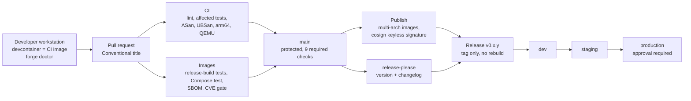

# SwarmForge

[](https://github.com/penchalj/swarmforge/actions/workflows/ci.yml)
[](https://github.com/penchalj/swarmforge/actions/workflows/images.yml)
[](https://github.com/penchalj/swarmforge/releases)

**A reproducible build, CI/CD and release platform for a C++/Python autonomy stack:
from developer laptop to signed, multi-arch release, promoted dev → staging → production.**

## What is SwarmForge?

SwarmForge is a small autonomy system plus the complete engineering platform
around it. The system itself is simple on purpose:

- **detector** (Python) simulates a sensor that sees moving targets and reports
  noisy positions.
- **fusion-node** (C++) uses a Kalman filter library, **libtrack**, to turn those
  noisy positions into smooth tracks: position and velocity for each target.
- Both talk through one shared **Protobuf** data contract, so C++ and Python
  always agree on the data format.

The real subject is the **platform**: how this code is built the same way on
every machine, tested automatically on every change, packaged for x86 servers
and ARM edge devices, signed so its origin can be proven, and released safely
through dev, staging and production.

It is an independent reference project; all data is synthetic.

## Objective

Show, with working evidence rather than claims, how I would design and own the
engineering platform for teams building autonomous, hardware-connected systems:

1. **Reproducible builds:** pinned compiler, OS and tools; no "works on my machine"
2. **Fast, trustworthy CI:** quick feedback, only the tests that matter, deep checks in parallel
3. **Hardware reach:** native arm64 builds and an emulated edge-device test
4. **Supply-chain integrity:** SBOMs, vulnerability gate, cryptographic signatures
5. **Safe releases:** automatic versioning, build once, promote by digest, approval, rollback
6. **Documented engineering:** every major decision and every real failure written down

## Results at a glance

All numbers are measured on this repository ([details](docs/performance/ci-timings.md)).

| What | Result |
|------|--------|
| Full CI lane (lint, tests, ASan, UBSan, native arm64, QEMU edge test) | **about 14 min cold → 4 min 34 s warm**, 6 jobs in parallel |
| Main build-and-test job | **15 min cold → 4 min warm** (Bazel repository + disk cache) |
| Pull request touching only Python | **2 of 4** test targets run (affected-test selection) |
| Docs-only pull request | **0** tests run |
| Sanitizer canaries | Planted heap overflow and integer overflow **caught** on every run |
| arm64 binary on emulated edge device (QEMU) | Velocity estimates within **0.09 m/s** of ground truth |
| Release | Tags the image CI already built: **identical digest**, nothing rebuilt |
| Promotion skipping staging (approved by a human) | **Blocked** by the pipeline |
| Production rollback | **46 s**, signature and smoke test still enforced |
| First vulnerability scan | 2 High CVEs found in the protobuf runtime, **fixed** (5.29.3 → 5.29.6) |

## Architecture



**The path of one change:** a developer works in the same container image CI
uses → a pull request runs 9 checks in parallel → on `main`, multi-arch images
are published and signed → release-please turns Conventional Commits into a
version and changelog → the release waits until every check passed on that
exact commit, then tags the already-signed images → a promotion workflow moves
them dev → staging → production by digest.

## What has been achieved

| Area | Done |
|------|------|
| **Build foundation** | Bazel monorepo (bzlmod), hermetic LLVM 17 toolchain, pinned Ubuntu 24.04 build image with no system compiler |
| **Product code** | C++20 Kalman tracker and fusion service, Python sensor simulator, shared Protobuf contract, unit, end-to-end and Compose tests |
| **Developer environment** | One command to build anywhere (`scripts/dev.sh`), devcontainer, `forge doctor` machine checks |
| **CI** | GitHub Actions with lint, affected-test selection, Bazel caching (written only by `main`), 9 required checks |
| **Deep checks** | ASan and UBSan on every PR with canaries, native arm64 build and test, arm64 binary run under QEMU |
| **Artefacts** | Minimal non-root runtime images for amd64 and arm64, SBOMs, critical-CVE gate, cosign keyless signatures |
| **Releases** | release-please versions and changelogs, releases only from fully green commits, build once |
| **Environments** | dev → staging → production by digest, order enforced, production approval, one-command rollback |
| **Maintenance** | Dependabot for actions and base-image digests, Conventional PR title check |
| **Documentation** | 6 Architecture Decision Records, Failure Lab with 11 real failures, measured timings, release drill |

Released versions: [v0.1.0 and v0.1.1](https://github.com/penchalj/swarmforge/releases), each with changelog, 4 SBOMs and a release manifest.

## How I built it

I built the platform in six focused stages, each delivered through pull
requests that had to pass the checks added before it:

| Stage | Focus |
|-------|-------|
| 1 | Bazel monorepo, hermetic LLVM toolchain, pinned build container |
| 2 | Shared Protobuf contract, C++ fusion service, Python detector, devcontainer |
| 3 | GitHub Actions CI with caching, affected tests and branch protection |
| 4 | Sanitizers with canaries, native arm64 lane, QEMU edge test |
| 5 | Runtime images, Compose test, SBOM, vulnerability gate, signing |
| 6 | Automated releases, promotion by digest, approval, rollback, `forge doctor` |

Working principles throughout:

- **Pin everything** (Bazel, compiler, OS image digests, tools), so results never drift.
- **Every change goes through a pull request** and the full pipeline, including my own.
- **Measure, don't guess:** every speed claim comes from a recorded CI run.
- **Treat failures as data:** each real problem got a root cause, a fix and a prevention ([Failure Lab](docs/failure-lab/README.md)).
- **Write decisions down** with the alternatives I rejected ([ADRs](docs/adr)).
- **Review automation's output:** for example, catching a wrong first version (1.0.0) and a changelog missing three features before releasing.

## Tools and their purpose

| Area | Tool | Purpose |
|------|------|---------|
| Build | **Bazel 8** (via Bazelisk) | Builds and tests C++ and Python in one monorepo, with caching and exact dependency tracking |
| Build | **bzlmod** + `MODULE.bazel.lock` | Pins every external dependency version |
| Build | **toolchains_llvm** (LLVM/Clang 17) | Hermetic C++ compiler, identical on every machine |
| Build | **rules_python** (Python 3.12) | Hermetic Python interpreter for builds and tests |
| Languages | **C++20**, **Python 3.12** | Tracker and fusion service; sensor simulator and tooling |
| Data contract | **Protobuf 29.3** | One schema generating matching C++ and Python code |
| Testing | **GoogleTest**, **unittest** | C++ and Python unit tests |
| Testing | **Docker Compose** | Runs the real runtime images together as an integration test |
| Testing | **ASan, UBSan** | Detect memory errors and undefined behaviour in C++ |
| Environment | **Docker** (pinned Ubuntu 24.04 image) | Same build environment on laptops and in CI |
| Environment | **Dev Containers** | One-click development environment in VS Code |
| Environment | **forge doctor** (own Python tool) | Checks a developer machine and explains fixes |
| Code quality | **clang-format**, **ruff**, **shellcheck**, **buildifier** | Formatting and lint for C++, Python, Bash and Bazel files |
| CI/CD | **GitHub Actions** | Runs the CI, Images, Release, Promote and PR title workflows |
| CI/CD | **Actions cache** | Stores Bazel downloads and build results between runs |
| CI/CD | **bazel query** | Selects only the tests affected by a change |
| CI/CD | **GitHub rulesets** | Protects `main` with 9 required checks |
| CI/CD | **GitHub Environments** | dev, staging, production with branch rules and approval |
| CI/CD | **Dependabot** | Proposes updates for actions and base-image digests |
| Multi-arch | **GitHub arm64 runners** | Native arm64 builds and tests |
| Multi-arch | **QEMU** | Runs the arm64 binary on an x86 machine, like an edge device |
| Multi-arch | **Docker Buildx** | Builds images and combines architectures under one tag |
| Supply chain | **GitHub Container Registry (GHCR)** | Stores the published images |
| Supply chain | **Syft** | Generates SBOMs (SPDX) for every image |
| Supply chain | **Grype** | Scans images for known vulnerabilities; fails on critical |
| Supply chain | **cosign / Sigstore** | Keyless signing, recorded in a public transparency log |
| Release | **release-please** | Versions and changelogs from Conventional Commits |
| Release | **crane** | Adds version and environment tags without changing the digest |
| Release | **GitHub Releases**, **GitHub CLI** | Publishes releases with assets; drives the workflows from the terminal |
| Docs | **ADRs**, **Mermaid** | Decision records and diagrams in the repository |

## How it maps to the role

| Requirement | Evidence |
|-------------|----------|
| Design CI/CD from scratch, own its architecture | [ci.yml](.github/workflows/ci.yml), [images.yml](.github/workflows/images.yml), [release.yml](.github/workflows/release.yml), [promote.yml](.github/workflows/promote.yml), [ADRs](docs/adr) |
| Bazel across C++ and Python | [MODULE.bazel](MODULE.bazel): bzlmod, hermetic LLVM 17, rules_python, protobuf; shared [proto](proto/detection.proto) |
| Caching, parallelisation, dependency management | Bazel repository + disk cache, PRs read-only (no cache poisoning), parallel jobs, [affected tests](scripts/affected_tests.sh), Dependabot |
| Reproducible developer and test environments | [Pinned build image](docker/dev.Dockerfile) used by laptop, [devcontainer](.devcontainer/devcontainer.json) and CI |
| Compiled software, ideally C++ | C++20 [Kalman tracker](libtrack), [fusion-node](fusion-node), ASan/UBSan with [canary tests](libtrack/test/sanitizer_canary_test.cc) |
| Cross-architecture and edge delivery | Native arm64 build and test, arm64 binary run under QEMU ([ADR 0004](docs/adr/0004-full-lane-sanitizers-arm64.md)) |
| Secrets, quality gates, release integrity | Cosign keyless (no long-lived keys), SBOM, CVE gate, least-privilege tokens ([ADR 0005](docs/adr/0005-release-images-sbom-signing.md)) |
| Release automation, environment promotion | release-please, build once / promote by digest, approval, rollback ([ADR 0006](docs/adr/0006-releases-and-promotion.md), [drill](docs/releases/rollback-drill.md)) |
| Internal tooling in Python and Bash | [forge doctor](tools/forge/forge.py) (tested), [scripts](scripts) checked by shellcheck |
| Debug difficult build and deployment failures | [Failure Lab](docs/failure-lab/README.md): 11 real failures with root cause and prevention |
| Make and defend trade-offs | [Architecture Decision Records](docs/adr) 0001–0006 |

## Try it in 5 minutes

Requirements: Docker with Compose, Python 3, and [cosign](https://docs.sigstore.dev/cosign/system_config/installation/) for the signature check.

```bash
git clone https://github.com/penchalj/swarmforge && cd swarmforge
python3 tools/forge/forge.py doctor        # checks your machine, explains fixes
./scripts/dev.sh bazel test //...          # builds and tests in the pinned image
./scripts/dev.sh ./scripts/lint.sh         # the same lint CI runs
```

Run the released images together (no build needed):

```bash
DETECTOR_IMAGE=ghcr.io/penchalj/swarmforge/detector:production \
FUSION_IMAGE=ghcr.io/penchalj/swarmforge/fusion-node:production \
  ./scripts/compose_test.sh
```

Verify that an image was built by this repository's CI on `main`:

```bash
cosign verify ghcr.io/penchalj/swarmforge/fusion-node:production \
  --certificate-identity "https://github.com/penchalj/swarmforge/.github/workflows/images.yml@refs/heads/main" \
  --certificate-oidc-issuer https://token.actions.githubusercontent.com
```

## What remains

Planned next steps, in rough priority order:

| Area | Next step |
|------|-----------|
| **Deployment targets** | k3s cluster with Argo CD (GitOps) and Ansible for on-prem hosts, consuming the environment tags |
| **Embedded / edge** | Yocto layer for the edge image; its SDK provides the arm64 sysroot for true cross-compilation; signed over-the-air updates |
| **Reproducibility** | Reproducible image builds (`SOURCE_DATE_EPOCH`), so unchanged content keeps its digest |
| **CI performance** | Shared remote cache (bazel-remote or BuildBuddy); automatic cleanup of outdated Actions caches |
| **Observability** | CI metrics (durations, cache hit rate, flaky tests) and DORA metrics on a Grafana dashboard |
| **Services** | gRPC between detector and fusion-node; ThreadSanitizer once the service is multi-threaded |
| **Portability** | GitLab CI version of the pipeline, to show the design is not tied to one CI vendor |
| **Supply chain** | Bazel-level SBOM covering libraries statically linked into the C++ binary |
| **Debugging** | Symbolized ASan stack traces (`llvm-symbolizer`) |

## Repository layout

```text
libtrack/          C++ Kalman tracker library (+ sanitizer canaries)
fusion-node/       C++ service: fuses detections into tracks
detector/          Python synthetic sensor
proto/             Shared Protobuf contract (C++ and Python)
tests/             End-to-end and Compose integration tests
tools/forge/       Developer tooling (forge doctor)
docker/            Pinned build image and minimal runtime images
scripts/           Build, lint, package, release and promotion scripts
.github/workflows/ CI, Images, Release, Promote, PR title
docs/              ADRs, Failure Lab, timings, release drill
```

## License

[Apache-2.0](LICENSE)